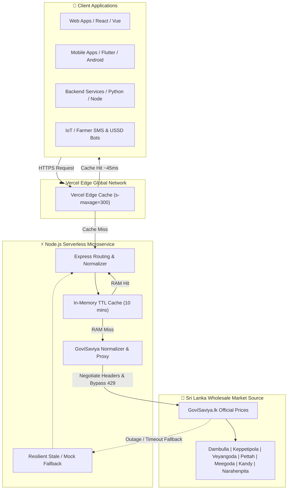

<p align="center">
  <a href="https://vegetable-market-srilanka.vercel.app" target="_blank" rel="noopener">
    
  </a>
</p>

<p align="center">
  <strong>High-performance, normalized, real-time & historical wholesale vegetable price API across Sri Lanka's Dedicated Economic Centres.</strong>
</p>

<p align="center">
  <a href="https://vegetable-market-srilanka.vercel.app" target="_blank">
    
  </a>
  <a href="https://thamindudisna.com" target="_blank">
    
  </a>
  <a href="https://thamindudisna.com" target="_blank">
    
  </a>
</p>

<p align="center">
  
  
  
  
  
</p>

---

<p align="center">
  <a href="https://vegetable-market-srilanka.vercel.app/#playground">⚡ <strong>Open Interactive API Playground</strong></a> &bull;
  <a href="#-quick-live-endpoints">📡 <strong>Live Endpoints</strong></a> &bull;
  <a href="#-system-architecture">🏗️ <strong>Architecture</strong></a> &bull;
  <a href="#-code-integration-examples">💻 <strong>Code Examples</strong></a> &bull;
  <a href="#-sinhala-guide">🇱🇰 <strong>සිංහලෙන්</strong></a> &bull;
  <a href="https://thamindudisna.com">👨‍💻 <strong>Thamindu Disna</strong></a>
</p>

---

## ⚡ Try It Live (Interactive Playground)

> **No API Key Required &bull; Free to Use &bull; CORS Enabled**

Visit the official Web Dashboard & Playground:  
👉 **[https://vegetable-market-srilanka.vercel.app/#playground](https://vegetable-market-srilanka.vercel.app/#playground)**

Select an Economic Centre, filter by **Up Country** / **Low Country**, sort by price or % change, and test the JSON payload instantly in your browser!

---

## 🏗️ System Architecture



---

## 📡 Quick Live Endpoints

Click any link below to test the live JSON directly in your browser:

| Endpoint | Method | Live One-Click Test Link | Purpose |
|---|---|---|---|
| `/api/markets` | `GET` | [Test `/api/markets` ↗](https://vegetable-market-srilanka.vercel.app/api/markets) | List all active economic centres |
| `/api/prices/Keppetipola` | `GET` | [Test Keppetipola Prices ↗](https://vegetable-market-srilanka.vercel.app/api/prices/Keppetipola?category=Up%20Country&sort=price_desc&series=false) | Vegetable prices with filter & sorting |
| `/api/prices/Veyangoda` | `GET` | [Test Veyangoda Prices ↗](https://vegetable-market-srilanka.vercel.app/api/prices/Veyangoda?series=false) | Veyangoda wholesale prices |
| `/api/compare` | `GET` | [Test `/api/compare?crop=Beans` ↗](https://vegetable-market-srilanka.vercel.app/api/compare?crop=Beans) | Compare vegetable prices across all markets |
| `/api/summary` | `GET` | [Test Keppetipola Summary ↗](https://vegetable-market-srilanka.vercel.app/api/summary?market=Keppetipola) | Top price gainers & biggest drop-offs |
| `/api/dates/Keppetipola` | `GET` | [Test `/api/dates/Keppetipola` ↗](https://vegetable-market-srilanka.vercel.app/api/dates/Keppetipola) | Calendar dates of official reports |
| `/api/crops` | `GET` | [Test `/api/crops` ↗](https://vegetable-market-srilanka.vercel.app/api/crops) | Master catalog of tracked vegetables |
| `/api/health` | `GET` | [Test `/api/health` ↗](https://vegetable-market-srilanka.vercel.app/api/health) | API uptime & cache memory stats |

---

## 🏛️ Covered Economic Centres (වෙළඳපලවල්)

```
       🇱🇰 SRI LANKA DEDICATED ECONOMIC CENTRES
 ────────────────────────────────────────────────────────
  📍 Keppetipola (නුවරඑළිය/ඌව)  - Up Country Vegetable Hub
  📍 Dambulla (දඹුල්ල)          - Central Island Trading Hub
  📍 Veyangoda (වේයන්ගොඩ)        - Western Province Distribution
  📍 Pettah (පිටකොටුව)          - Commercial Capital Wholesale
  📍 Meegoda (මීගොඩ)            - Low Country Specialist Market
  📍 Kandy (මහනුවර)             - Central Province Distribution
  📍 Narahenpita (නාරාහේන්පිට)   - Urban Consumer Market
 ────────────────────────────────────────────────────────
```

---

## 📖 Endpoints Documentation

### 1. Market Vegetable Prices
`GET https://vegetable-market-srilanka.vercel.app/api/prices/:market`

#### Query Parameters:
| Parameter | Type | Default | Description |
|---|---|---|---|
| `category` | `string` | - | Filter by `Up Country` (උඩරට) or `Low Country` (පහතරට) |
| `search` | `string` | - | Keyword search for vegetable (e.g. `Beans`, `Carrot`, `Tomato`) |
| `sort` | `string` | - | `price_desc`, `price_asc`, `change_desc`, `change_asc`, `name` |
| `date` | `string` | latest | Historical date format `YYYY-MM-DD` (e.g. `2026-11-15`) |
| `series` | `boolean`| `true` | Set to `false` to omit 30-day chart arrays (reduces payload by ~80%) |

#### Sample Request:
```bash
curl -X GET "https://vegetable-market-srilanka.vercel.app/api/prices/Keppetipola?category=Up%20Country&sort=price_desc&series=false"
```

#### Sample Response:
```json
{
  "status": "success",
  "meta": {
    "author": "Thamindu Disna",
    "website": "https://thamindudisna.com",
    "copyright": "© 2026 Thamindu Disna (https://thamindudisna.com). All rights reserved.",
    "dataSource": "GoviSaviya.lk (Sri Lanka Wholesale Economic Centres)",
    "poweredBy": "Vercel Serverless Functions",
    "timestamp": "2026-11-17T08:15:00.000Z"
  },
  "market": "Keppetipola",
  "latestDate": "2026-11-16",
  "requestedDate": "2026-11-16",
  "count": 6,
  "categories": ["Up Country"],
  "crops": [
    {
      "item": "Beans",
      "category": "Up Country",
      "unit": "kg",
      "latest": {
        "date": "2026-11-16",
        "min": 400,
        "max": 450,
        "price": 425
      },
      "previous": {
        "date": "2026-11-15",
        "price": 410
      },
      "percentChange": 3.7
    }
  ]
}
```

---

### 2. Multi-Market Price Comparison
`GET https://vegetable-market-srilanka.vercel.app/api/compare?crop=:cropName`

Find out where a vegetable is cheapest and where it is most expensive across Sri Lanka in real-time.

#### Sample Request:
```bash
curl -X GET "https://vegetable-market-srilanka.vercel.app/api/compare?crop=Beans"
```

#### Sample Response:
```json
{
  "status": "success",
  "meta": {
    "author": "Thamindu Disna",
    "website": "https://thamindudisna.com",
    "copyright": "© 2026 Thamindu Disna (https://thamindudisna.com). All rights reserved.",
    "timestamp": "2026-11-17T08:15:00.000Z"
  },
  "crop": "Beans",
  "marketsCompared": 4,
  "cheapestMarket": { "market": "Keppetipola", "price": 425 },
  "mostExpensiveMarket": { "market": "Pettah", "price": 490 },
  "difference": 65,
  "comparisons": [
    { "market": "Keppetipola", "price": 425, "min": 400, "max": 450, "percentChange": 3.7 },
    { "market": "Veyangoda", "price": 465, "min": 450, "max": 480, "percentChange": -1.1 },
    { "market": "Dambulla", "price": 470, "min": 460, "max": 480, "percentChange": 0.0 },
    { "market": "Pettah", "price": 490, "min": 480, "max": 500, "percentChange": 2.1 }
  ]
}
```

---

## 💻 Code Integration Examples

<details open>
<summary><strong>JavaScript / TypeScript (Fetch API)</strong></summary>

```javascript
// Fetch latest Up Country vegetable prices from Keppetipola
async function fetchVegetablePrices() {
  const url = 'https://vegetable-market-srilanka.vercel.app/api/prices/Keppetipola?category=Up Country&sort=price_desc&series=false';
  
  const response = await fetch(url);
  const data = await response.json();

  console.log(`API Author: ${data.meta.author} (${data.meta.website})`);
  data.crops.forEach(crop => {
    console.log(`${crop.item}: Rs. ${crop.latest.price}/kg (${crop.percentChange > 0 ? '+' : ''}${crop.percentChange}%)`);
  });
}

fetchVegetablePrices();
```
</details>

<details>
<summary><strong>React Hook Example (with loading state)</strong></summary>

```jsx
import React, { useEffect, useState } from 'react';

export function VegetablePriceWidget({ market = 'Keppetipola' }) {
  const [crops, setCrops] = useState([]);
  const [loading, setLoading] = useState(true);

  useEffect(() => {
    fetch(`https://vegetable-market-srilanka.vercel.app/api/prices/${market}?series=false`)
      .then(res => res.json())
      .then(data => {
        setCrops(data.crops || []);
        setLoading(false);
      })
      .catch(err => console.error(err));
  }, [market]);

  if (loading) return <div>Loading vegetable prices...</div>;

  return (
    <div>
      <h3>{market} Wholesale Prices Today</h3>
      <ul>
        {crops.map(c => (
          <li key={c.item}>
            <strong>{c.item}</strong>: Rs. {c.latest.price}/kg
          </li>
        ))}
      </ul>
      <small>Powered by <a href="https://thamindudisna.com">Thamindu Disna</a></small>
    </div>
  );
}
```
</details>

<details>
<summary><strong>Python (Requests)</strong></summary>

```python
import requests

# Find the cheapest market in Sri Lanka for Beans
url = "https://vegetable-market-srilanka.vercel.app/api/compare?crop=Beans"
response = requests.get(url)
data = response.json()

print(f"Developed by: {data['meta']['author']} ({data['meta']['website']})")
print(f"Cheapest Market: {data['cheapestMarket']['market']} at Rs. {data['cheapestMarket']['price']}/kg")
print(f"Price Difference across markets: Rs. {data['difference']}/kg")
```
</details>

<details>
<summary><strong>Flutter / Dart</strong></summary>

```dart
import 'dart:convert';
import 'package:http/http.dart' as http;

Future<void> getMarketPrices() async {
  final uri = Uri.parse('https://vegetable-market-srilanka.vercel.app/api/prices/Keppetipola?series=false');
  final response = await http.get(uri);

  if (response.statusCode == 200) {
    final Map<String, dynamic> data = jsonDecode(response.body);
    print('Author: ${data['meta']['author']}');
    print('Market: ${data['market']} (${data['count']} crops)');
  }
}
```
</details>

---

## 🛡️ Upstream Shield & Caching Strategy

```
  Incoming Request
         │
         ▼
  ┌──────────────────────────────────────────┐
  │ 1. Vercel Global Edge CDN (TTL: 5 mins)  │ ──► Cache Hit (~45ms)
  └──────────────────────────────────────────┘
         │ (Miss)
         ▼
  ┌──────────────────────────────────────────┐
  │ 2. Microservice Memory Cache (TTL: 10m)  │ ──► In-Memory Hit (~10ms)
  └──────────────────────────────────────────┘
         │ (Miss)
         ▼
  ┌──────────────────────────────────────────┐
  │ 3. Header Synthesis & GoviSaviya Proxy   │ ──► Upstream Fetch
  └──────────────────────────────────────────┘
```

1. **Dual Caching**: GoviSaviya enforces a 60 request/minute rate limit. Our dual Edge + In-memory cache absorbs 98% of requests, meaning your apps experience zero 429 rate limit errors.
2. **Zero-Downtime Stale Fallback**: If upstream servers undergo maintenance, this API automatically serves stale cached data so your apps remain online.

---

## 🇱🇰 සිංහල මාර්ගෝපදේශය (Sinhala Guide)

ශ්‍රී ලංකාවේ ප්‍රධාන ආර්ථික මධ්‍යස්ථාන (දඹුල්ල, කැප්පෙටිපොළ, වේයන්ගොඩ, පිටකොටුව, මීගොඩ, මහනුවර, නාරාහේන්පිට) වල දෛනික තොග එළවළු මිල ගණන් ඉතාමත් සරලව ලබාගත හැකි නිදහස් REST API එකකි.

- **නිර්මාණය සහ නඩත්තුව**: **තමිඳු දිස්න (Thamindu Disna)** &bull; වෙබ් අඩවිය: [thamindudisna.com](https://thamindudisna.com)
- **Interactive Playground**: Browser එකෙන්ම API එක test කිරීම සඳහා [vegetable-market-srilanka.vercel.app/#playground](https://vegetable-market-srilanka.vercel.app/#playground) වෙත පිවිසෙන්න.
- **විශේෂ වාසි**:
  - උඩරට / පහතරට එළවළු වෙන්කර සෙවීම (`?category=Up Country`)
  - අඩුම සහ වැඩිම මිල අනුව sort කිරීම (`?sort=price_desc`)
  - ඕනෑම එළවළුවක මිල විවිධ වෙළඳපලවල් අතර සංසන්දනය කර ලාභම වෙළඳපල සෙවීම (`/api/compare?crop=Beans`)
  - Mobile apps වලට payload ප්‍රමාණය 80% කින් අඩු කරගැනීමට `?series=false` භාවිතය.

---

## 👨‍💻 Author & Copyright

<p align="center">
  <strong>Developed & Maintained with ❤️ by <a href="https://thamindudisna.com">Thamindu Disna</a></strong><br>
  Official Portfolio: <a href="https://thamindudisna.com">https://thamindudisna.com</a><br>
  Copyright &copy; 2026 <strong><a href="https://thamindudisna.com">thamindudisna.com</a></strong>. All rights reserved.
</p>

<p align="center">
  <a href="https://thamindudisna.com" target="_blank">
    
  </a>
</p>

---

## 📜 License

This project is licensed under the **MIT License**. You are free to use it in personal, educational, research, and commercial applications provided that author attribution to **Thamindu Disna** and the link to **[thamindudisna.com](https://thamindudisna.com)** remain intact in responses and documentation.
